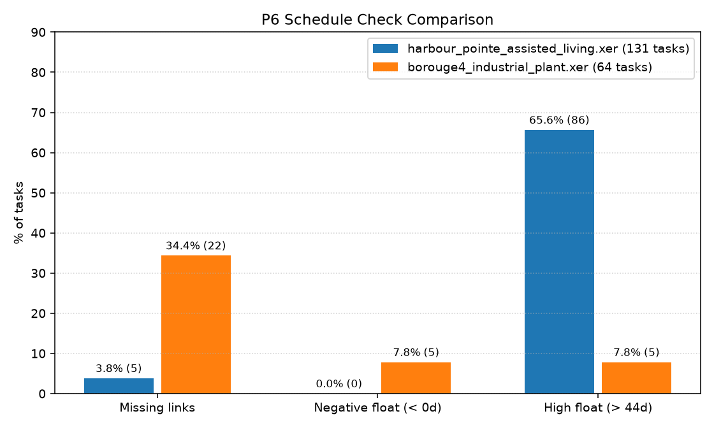

# P6 XER Schedule Checker

Reads Primavera P6 `.xer` schedule files, flags broken rows, runs 3 checks (missing links, negative float, high float), and saves a comparison chart to `chart.png`.



## Usage

```bash
pip install -r requirements.txt

# Run on both schedules in schedules/ and update chart.png
python3 checker.py

# Run on a sample file with broken rows
python3 checker.py tests/broken_sample.xer

# Run tests
python3 -m unittest discover -s tests
```

## Sample Files

- `schedules/harbour_pointe_assisted_living.xer` (`EC00610`, 131 tasks, 212 links)
- `schedules/borouge4_industrial_plant.xer` (`BOROUGE4_DEMO`, 64 tasks, 52 links)

## Check Rules

- **Broken rows**: `%R` rows whose column count does not match the table's `%F` header, missing or duplicate `task_id` in `TASK`, non-numeric `total_float_hr_cnt`, invalid `*_date` values, or `TASKPRED` rows pointing to a missing `task_id`.
- **Missing links**: Tasks with no predecessor (start milestones `TT_Mile` exempt) or no successor (finish milestones `TT_FinMile` exempt).
- **Negative float**: `total_float_hr_cnt < 0`.
- **High float**: `total_float_hr_cnt / day_hr_cnt > 44` working days (defaults to 8 hours/day if no default calendar is set).
